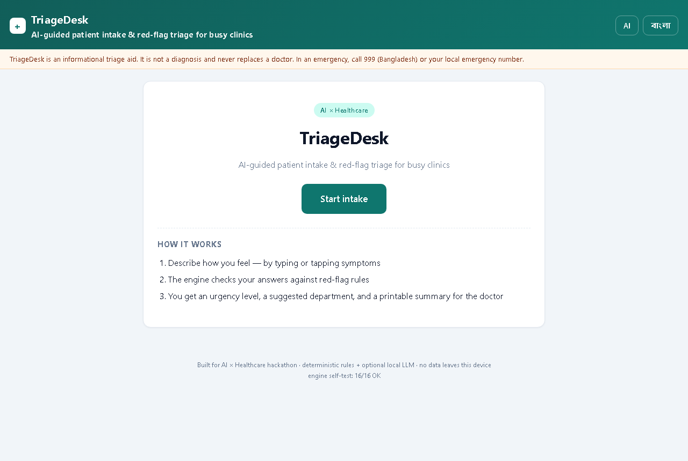
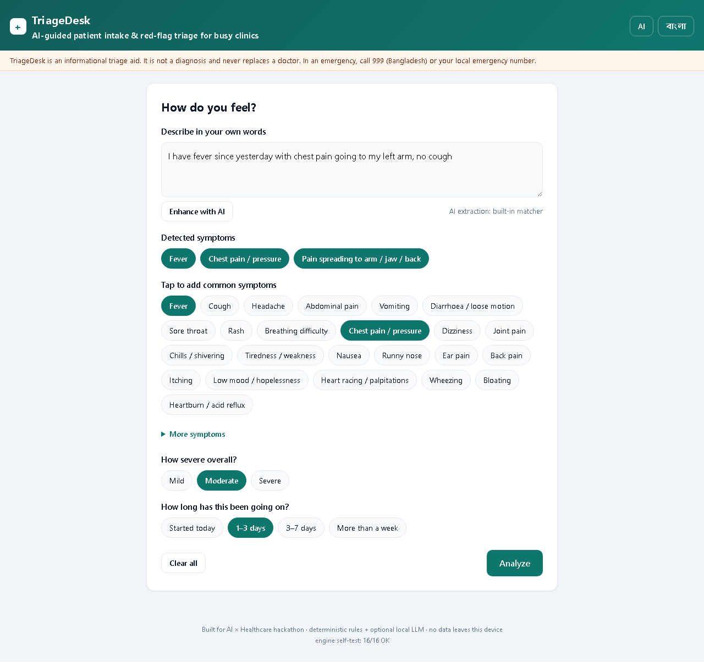
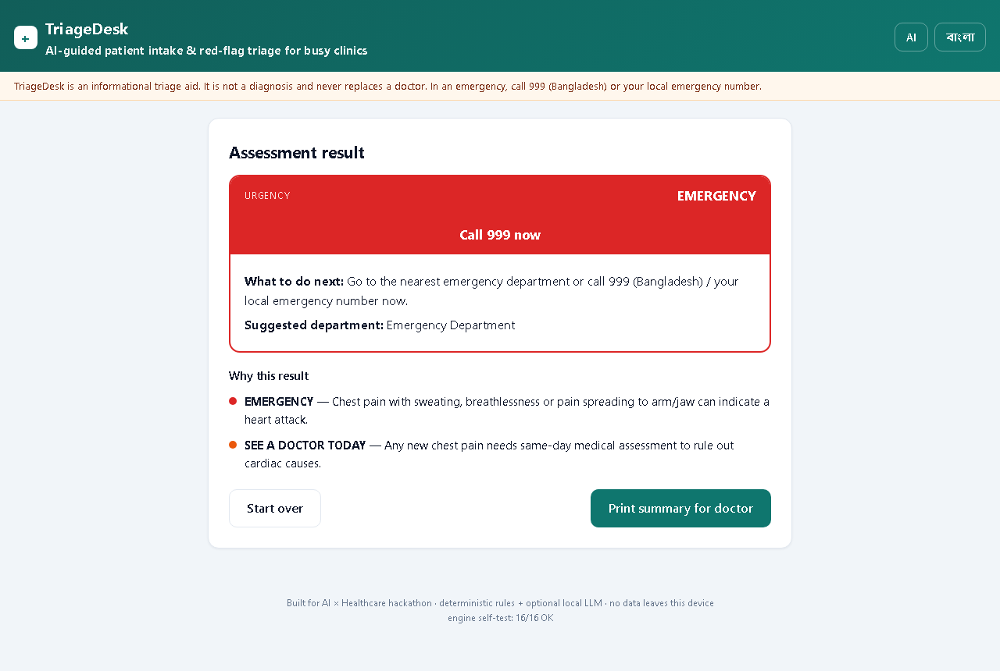
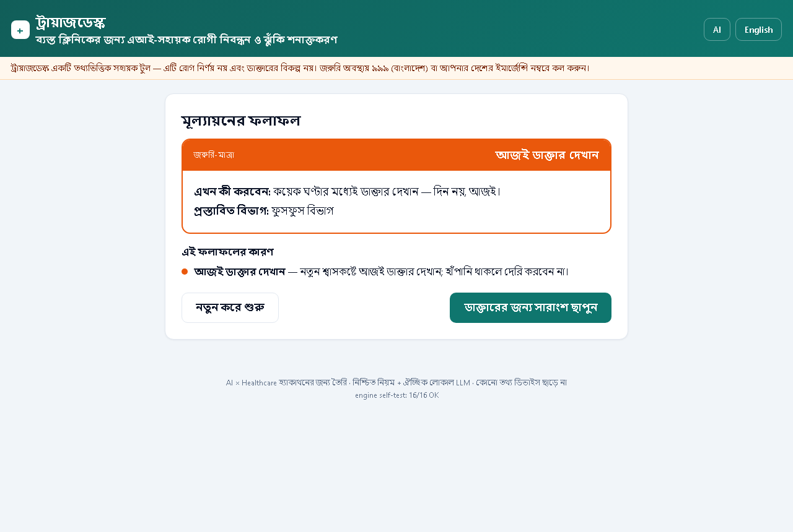

# TriageDesk

**AI-guided patient intake & red-flag triage for busy clinics.**
Built for the AI × Healthcare hackathon (DSH Hacks V2).

A patient describes how they feel — by typing freely or tapping symptoms — and TriageDesk
returns an **urgency level** (Emergency / See a doctor today / Within days / Home care),
a **suggested department**, and a **printable one-page summary** the patient hands to the doctor.

> **This is an informational triage aid, not a diagnosis.** It never replaces a
> clinician. In an emergency, call 999 (Bangladesh) or your local emergency number.

## Why

In crowded outpatient departments, the first minutes are spent on paperwork and
queue guessing. Serious presentations (cardiac chest pain, stroke signs, meningitis
triad) must surface immediately — before the queue. TriageDesk gives the front desk
(or the patient themselves) a 60-second structured intake that flags red flags first,
in the two languages Bangladeshi patients actually use.

## What it does

- **Bilingual intake** — full English + বাংলা interface, one-tap switch
- **Free-text symptom extraction** — bilingual phrase matching with a negation guard
  ("no cough", "কাশি নেই" both correctly ignored); 65-symptom taxonomy
- **Deterministic red-flag engine** — 33 transparent rules (stroke FAST signs, cardiac
  chest-pain patterns, meningitis fever+neck-stiffness, anaphylaxis, obstetric
  emergencies, infant fever, and more). Every fired rule is shown to the user with a
  plain-language reason — no black box
- **Context-aware escalation** — age bands (any fever under 3 months = emergency),
  pregnancy, chronic conditions (diabetes / immunosuppression upgrade fevers)
- **Doctor summary** — clean printable one-page intake sheet for the clinic record
- **Optional LLM enhancement** — connect any OpenAI-compatible endpoint (local Ollama,
  Groq, …) to improve extraction. The triage logic itself never depends on an LLM:
  same input, same result, every time

## Architecture

```
app/
├── index.html          # shell (zero external assets — fully offline-capable)
├── css/styles.css      # clinical UI theme + print stylesheet
└── js/
    ├── data.js         # symptom taxonomy + rule matrix (EN/BN)
    ├── engine.js       # extraction + deterministic evaluation + self-test
    ├── i18n.js         # UI strings (EN/BN)
    └── app.js          # screens & wiring
tests/
├── engine.test.js      # regression harness (16 triage cases + 10 extraction cases)
└── probe-body.js
```

No build step, no framework, no network dependency. The whole app is static — it can
run from a USB stick inside a clinic with no internet.

## Run

Open `app/index.html` in any browser — that's it.

## Tests

```
node tests/engine.test.js
```

Current status: **TRIAGE 16/16 · EXTRACTION 10/10** — including edge cases
(negation in both languages, infant-fever escalation, chronic-condition escalation,
stroke/chest-pain patterns, false-positive guards for "blood pressure" / "back pain").

## Honest disclosure

- The free-text matcher is a phrase + synonym matcher with negation windows, not a
  neural NLP model. It is disclosed as a heuristic. The optional LLM mode is a
  bring-your-own-key integration and is off by default.
- The rule matrix encodes widely published red-flag consensus patterns (e.g. FAST
  stroke signs, classic cardiac presentation features, meningitis triad). It is a
  demonstration of triage workflow design, not a clinically validated medical device.
- No patient data leaves the device. Nothing is stored except the optional LLM
  configuration, which lives in the browser's local storage.

## Screenshots

| | |
|---|---|
|  |  |
|  |  |

## License

MIT
